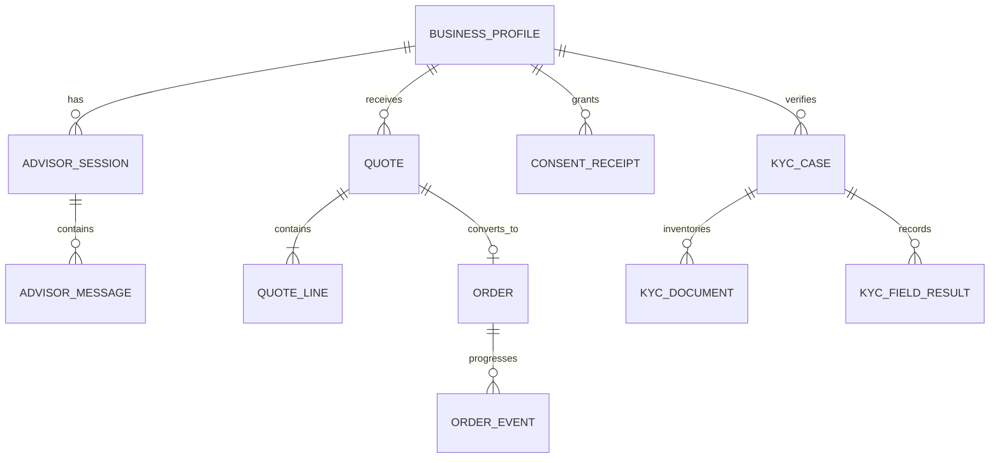

# Data model (proposed)

SQLite is the initial local database. Use explicit migrations and repository interfaces. Store only fields required for the prototype; keep uploaded documents out of the relational database unless an approved retention/encryption design is implemented.

## Entity ownership and key fields

- **BusinessProfile:** internal ID, business type/segment, city/tier/state, employee/site counts, preferred language. Keep contact data separate and optional.
- **AdvisorSession / AdvisorMessage:** session state and minimized conversational data. Define deletion policy; do not place KYC identifiers in prompts/messages.
- **Product:** imported/versioned catalogue attributes. Preserve source values and record import/version; do not edit audited CSV in place.
- **Quote / QuoteLine:** immutable pricing snapshot, product/version, quantity/unit, unit price, monthly line amount, setup, term and expiry. Store integer currency values.
- **ConsentReceipt:** purpose, notice version, affirmative action, time, scope and revocation state.
- **KycCase / KycDocument / KycFieldResult:** document type, protected storage reference, processing state, OCR result references, field status/reason and reviewer action. Avoid storing full identifiers in general logs.
- **Order / OrderEvent:** accepted quote snapshot, current state and append-only state events; tracker is a projection of events.

## Data ownership boundaries

Catalogue module owns product/eligibility data. Quotation owns quote snapshots. KYC owns consent-linked document references and field decisions. Order owns accepted commercial state. Tracking reads order events. LLM provider owns no authoritative business state. Mock registry adapters may read local synthetic CSV-derived data but do not own customer records.

Add database constraints for unique IDs, allowed states, nonnegative quantities/prices and referential integrity. Migrations must be reversible where practical. Protect SQLite files and backups; `.db`, WAL/SHM files and backups are Git-ignored.
