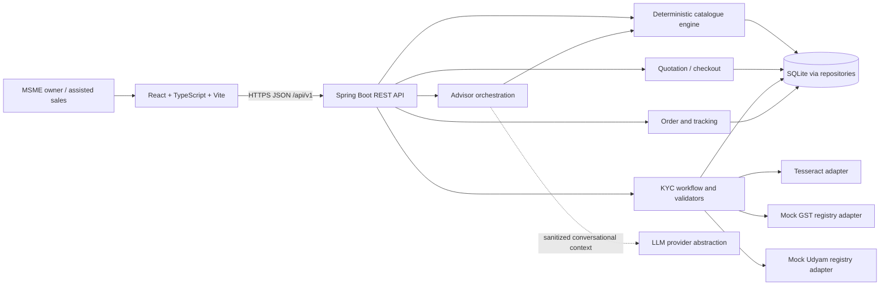

# System architecture

## Overview

Project Udyam Digital is a modular monolith. A mobile-first React client communicates with a versioned Spring Boot REST API. Domain decisions remain on the server. SQLite is the initial persistence choice for the local prototype; repositories isolate persistence so production storage can change independently.

The diagram describes intended architecture, not implemented integrations. The only backend endpoint implemented at foundation stage is health. Mock registries are local synthetic data; any production registry, DigiLocker, e-sign, payment or messaging integration requires separate authorization and compliance review.

## Communication and trust boundaries

- Browser to backend: JSON REST under `/api/v1`; production deployment must use HTTPS, authentication, authorization, CSRF/CORS policy appropriate to the hosting topology, request limits and rate limits.
- Backend to persistence: domain services call repository interfaces; only persistence adapters know SQLite details.
- Backend to OCR/registry/model providers: adapters isolate network/process details, timeouts and error mapping. No provider secrets are sent to the frontend.
- KYC documents and identifiers are sensitive inputs. Keep files outside public web roots, apply consent before processing, minimize retention, and mask values in logs/responses.

## Business-rule authority

Catalogue eligibility, dependency resolution, price arithmetic, KYC state transitions and validation outcomes are deterministic Java services. The advisor may gather answers and explain a server-produced recommendation. An LLM may not create product IDs, modify eligibility, change prices, waive KYC failures, or advance order state. The server validates every submitted product/quantity and recomputes quote totals at checkout. LLM output is treated as untrusted text and constrained to an approved result context.

## Main data flows

1. Advisor captures business profile and needs; backend evaluates catalogue rules and returns eligible options plus reason codes.
2. Quote endpoint calculates totals from catalogue data and confirmed quantities; checkout revalidates before creating an order.
3. Consent precedes document upload and each mock registry lookup. OCR candidates are user-correctable and flow through validators; uncertain fields route to manual review.
4. Order events are persisted and exposed through a minimal owner-facing tracker.

## Failure handling

Use a consistent JSON error envelope with stable code, safe message, request ID and field issues. Do not include raw identifiers, OCR text or stack traces in client errors. Map validation failures to 400/422, missing resources to 404, conflicts to 409, throttling to 429, dependency timeouts/unavailability to 503, and unexpected faults to 500. Registry/OCR outage must not bypass eligibility or produce a false KYC pass. Retry only idempotent calls; use idempotency keys for future order creation.
